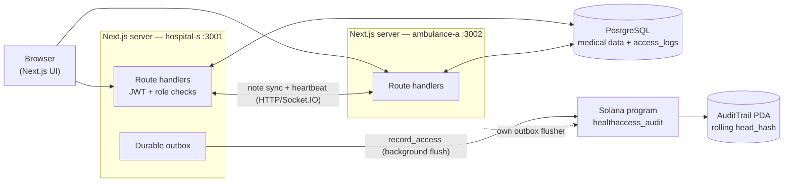

# HealthAccess — Tamper-evident medical record access auditing on Solana

Every time someone opens a patient record, that access is committed to the
Solana blockchain. The medical data stays in PostgreSQL; the chain holds a
rolling hash of the access log, so the log cannot be rewritten after the fact.
Patients can see who looked at their records — and prove nobody edited the log
afterward.

Colosseum Crypto World's Fair · Solana track.

## Origin

This project began as a course assignment (Inl 3) built on a custom in-memory
hash chain. That implementation is preserved in the git history. The Solana
program, its tests, and the audit pipeline were built during the Colosseum
Crypto World's Fair hackathon. The move to Solana is itself the point: the
prototype had no signatures, so *immutable* was a claim rather than a
guarantee. Here the guarantee is the chain.

See [`docs/hackathon/INTERFACE-CONTRACT.md`](docs/hackathon/INTERFACE-CONTRACT.md)
for the frozen design and [`docs/hackathon/FUTURE-WORK.md`](docs/hackathon/FUTURE-WORK.md)
for what is deliberately not built yet.

## The problem

GDPR gives patients the right to know who accessed their records. The systems
that hold those records — health providers, EHR vendors, insurers — keep an
audit log, and the party being audited is the same party that owns the log.
A log you can edit is not evidence.

## How it works

- **Medical data never touches the chain.** It lives in PostgreSQL. Only access
  *events* are committed on-chain, and only in pseudonymous form.
- **A rolling hash chain on Solana.** Each event folds into a running head:
  `head = sha256(prev_hash || borsh(event))`. The head is stored in a single
  `AuditTrail` PDA. Rewriting any past event changes every hash after it, and
  the on-chain head no longer matches — the tamper is visible.
- **A durable outbox.** A record access is written to Postgres first
  (`pending`), then a background flusher submits it to the program. Every
  attempt re-reads the current head, so two servers racing on one PDA resolve
  by re-read-and-retry rather than last-write-wins.
- **An off-chain mirror you can audit.** Once anchored, the row carries the
  Solana `slot`, `signature`, and the `head_hash` it committed to. The API can
  compare the local mirror against chain state and report a match.

### Privacy boundary

- Medical data: PostgreSQL only. **Never** on chain, not even hashed content.
- On chain: pseudonymous access events. Patient and user ids are salted
  (`ACCESS_HASH_SALT`) and hashed **before** they reach the program, so the
  ledger carries accountability, not linkable identity.
- Authorization: enforced server-side with a JWT in an httpOnly cookie and
  role checks. The program does not decide who may read a record — it only
  guarantees the log is append-only.
- **The honest limit:** on-chain commitment prevents *retroactive* alteration.
  It does not prove a malicious server logged truthfully at write time. That
  distinction is the difference between a claim and a guarantee.

### Architecture



Full diagrams: [`docs/diagrams/`](docs/diagrams/) — system context, data flow,
and the access-log sequence.

## Navigate the code

The repository is mapped with **[ripwire](docs/ripwire.md)**, a deterministic
call-graph CLI (no LLM, no API key). Point it at the tree and it ranks every
symbol, so you — or an AI agent — can find code before opening files:

```bash
ripwire .                                   # ranked map of the repo
ripwire . --for="how the outbox flusher retries"   # orient on a task
ripwire . --expand=flushEntry                # one symbol's body + callee signatures
```

The committed outputs are [`ripwire-out/graph.html`](ripwire-out/graph.html)
(interactive) and [`ripwire-out/GRAPH_REPORT.md`](ripwire-out/GRAPH_REPORT.md)
(architecture summary); regenerate both with `npm run ripwire`. Agents that read
[`AGENTS.md`](AGENTS.md) pick up the workflow automatically. The architecture
review derived from ripwire is in
[`docs/ARCHITECTURE_REVIEW.md`](docs/ARCHITECTURE_REVIEW.md).

## Quick start

**Requires:** Node 22+, npm, and either Docker or a local PostgreSQL 16.

```bash
git clone git@github.com:matdevstamp/healthaccess-solana.git
cd healthaccess-solana
npm ci                       # installs deps and runs prisma generate
cp .env.example .env         # sets DATABASE_URL and demo defaults
npm run db:up                # starts a local PostgreSQL 16 container
npm run db:migrate           # creates the tables
npm run db:seed              # test users, a patient, and sample notes
npm run dev                  # http://localhost:3001
```

Seed logins are all `*_test` / `test123`:

| Username | Role |
|---|---|
| `dr_test` | doctor |
| `nurse_test` | nurse |
| `amb_test` | ambulance |
| `vc_test` | primary_care |
| `patient_test` | patient |
| `unauth_test` | unauthorized |

The app boots with an empty `SOLANA_PROGRAM_ID`: the audit view works
off-chain and `/api/health` reports `programDeployed: false` instead of
failing. To read and anchor on-chain, set `SOLANA_PROGRAM_ID` and generate a
salt:

```bash
openssl rand -hex 32   # paste into ACCESS_HASH_SALT in .env — never commit it
```

### Two servers (the P2P demo)

The demo runs the same build as two instances, so one node's note appears on the
other live:

```bash
npm run build
SERVER_ID=hospital-s  npm run start -- -p 3001 &   # peer: 3002
SERVER_ID=ambulance-a npm run start -- -p 3002 &   # peer: 3001
```

`PEER_URL` is derived from `SERVER_ID` unless set explicitly. `PEER_SECRET`
must match in both instances; it authenticates the `/api/p2p/*` calls. The
value in `.env.example` is a placeholder — change it outside a solo dev box.

## The program

| | |
|---|---|
| Program | `healthaccess_audit` (Anchor) |
| Program ID | `Co2EarRRbhBbisT1dcVoeYuNNs3fuRR1zFdyRd3ewxrE` |
| Cluster | devnet (deploy config in `Anchor.toml`; localnet deploy works today) |
| State | one `AuditTrail` PDA, seeds `[b"audit_trail"]`, 82 bytes |
| Payload | 83-byte fixed `AccessEvent` — no `String`, no `Vec`, no PII |
| Instructions | `initialize`, `record_access` |
| Source | [`programs/healthaccess_audit/`](programs/healthaccess_audit/) |
| IDL | [`idls/healthaccess_audit.json`](idls/healthaccess_audit.json) |

`record_access` requires `prev_hash` to equal the current head (`ChainBroken`
otherwise), folds the new event into the head, increments the event count, and
emits `AccessLogged`.

### Build and deploy

```bash
# Localnet (works today):
anchor build -- --features anchor      # the feature flag is required; see notes
anchor deploy --provider.cluster localnet

# Devnet (after funding the keypair):
solana airdrop 2                       # rate-limited; retry
SOLANA_PROGRAM_ID=<id> npm run build   # bake the id into the app
```

Then set `SOLANA_PROGRAM_ID` in `.env`.

**Deployment caveat.** The program keypair lives in `keys/` and is gitignored —
a public repo must not leak spend authority. A fresh clone therefore cannot
regenerate the *same* address: `anchor build` would mint a new keypair. The
committed IDL and the `declare_id_matches_committed_idl()` guard keep the
committed binary honest, but only the original keypair can redeploy to the
address above. Back that file up.

## Environment variables

| Variable | Default | Purpose |
|---|---|---|
| `SERVER_ID` | `hospital-s` | Which demo instance this is (`hospital-s` / `ambulance-a`) |
| `PORT` | `3001` | HTTP port (server 2 uses `3002`) |
| `DATABASE_URL` | local Postgres | Prisma connection string |
| `JWT_SECRET` | — | Signs session cookies; **required at login** |
| `JWT_EXPIRES_IN` | `24h` | Session lifetime |
| `PEER_URL` | derived | The other instance's base URL |
| `PEER_HEARTBEAT_MS` | `10000` | Peer ping interval |
| `PEER_SECRET` | — | Shared secret for `/api/p2p/*` (same on both instances) |
| `SOCKET_CORS_ORIGIN` | both origins | Socket.IO CORS allow-list |
| `SOLANA_RPC_URL` | devnet | Cluster RPC endpoint |
| `SOLANA_CLUSTER` | `devnet` | Cluster name, for display/health |
| `SOLANA_COMMITMENT` | `confirmed` | `processed` / `confirmed` / `finalized` |
| `SOLANA_PROGRAM_ID` | *(empty)* | Deployed program; empty ⇒ `programDeployed: false` |
| `SOLANA_KEYPAIR_PATH` | `~/.config/solana/devnet.json` | Signing keypair (outside the repo) |
| `ACCESS_HASH_SALT` | — | **Secret.** 32-byte hex that salts ids before hashing. **Never commit.** |

`ACCESS_HASH_SALT` and `JWT_SECRET` are read lazily, so the app boots for
unrelated work and fails only when the value is actually needed.

## API

| Method | Path | Purpose | Roles |
|---|---|---|---|
| POST | `/api/auth/login` | Log in, set the JWT cookie | all |
| POST | `/api/auth/logout` | Clear the session | authenticated |
| GET | `/api/auth/me` | Current user | authenticated |
| GET | `/api/health` | Status incl. `solana.programDeployed`, `headHash`, `pendingEvents` | public |
| GET | `/api/patients` | Search + paginate patients | staff |
| GET | `/api/patients/:id` | Patient + journal view | staff, patient (own) |
| GET | `/api/notes?recordId={id}` | Notes for a record, per visibility | staff, patient |
| POST | `/api/notes` | Create a note | staff |
| PATCH / DELETE | `/api/notes/:id` | Edit / delete an own note | staff |
| GET | `/api/access-log` | Access log + chain verification | all |
| POST | `/api/p2p/note` | Peer note sync (shared-secret auth) | P2P |
| GET | `/api/records` | Not implemented (`501`) | — |

Contract detail: [`docs/api/README.md`](docs/api/README.md).
P2P routes authenticate with the `x-peer-secret` header, not a user session.

## Testing

| Layer | Tool | Command | Covers |
|---|---|---|---|
| Unit + integration | Vitest | `npm run test:unit` | Auth, visibility rules, hash chain, outbox flusher, Solana encoding, patient APIs |
| Rust | `cargo test --features anchor` | — | Pure hash chain + program logic |
| E2E | Playwright | `npm run test:e2e` | Full flows against two real servers |
| Solana E2E | Playwright | `npm run test:e2e:solana` | On-chain anchoring (skips unless `SOLANA_PROGRAM_ID` is set) |

`npm run test:unit:coverage` enforces a 70% threshold over `src/lib/**/*.ts` and
`src/app/api/**/route.ts`. `npm run test` runs unit → build → E2E.

E2E boots `next start`, so a production build must exist first; `npm run test`
builds it for you. Install the browser once with `npm run test:install`.

## Demo

The demo is recorded, not clicked live. `demo/` generates a narration track and
MP4s from the running app:

```bash
npm run demo            # narrate → record → compose
DEMO_SET=parallel npm run demo   # split-screen two-server version
```

Videos land in `demo/out/` and are not committed. See
[`demo/README.md`](demo/README.md).

## What is not shipped (and why)

Documented rather than hidden — see
[`docs/hackathon/FUTURE-WORK.md`](docs/hackathon/FUTURE-WORK.md):

- **Patient wallet consent (task 33).** Letting a patient connect a Solana
  wallet and record consent on-chain would change the frozen 83-byte payload,
  so it was scoped out for the deadline.
- **Devnet deployment.** Deploy config and app wiring are done; the public
  devnet deploy is blocked on a funded keypair.
- **LiteSVM integration tests.** Blocked on a Solana toolchain version
  collision (`docs/hackathon/KNOWN-ISSUES.md`); the pure-model and app-level
  tests cover the same rules today.

## Repository layout

```
programs/healthaccess_audit/   Anchor program (Rust)
idls/                          Committed IDL (source of truth for the client)
src/lib/solana/                TS client: encoding, PDA, chain reads
src/lib/outbox/                Durable outbox: store, flusher, verify
src/lib/p2p/                   Peer sync + heartbeat
src/app/api/                   Route handlers
prisma/                        Schema + migrations + seed
e2e/                           Playwright specs (app + blockchain)
demo/                          Reproducible recorded demo
ripwire-out/                   Generated call graph + architecture report
docs/                          API, database, diagrams, hackathon notes
```

## Tech stack

- Next.js (React + route handlers in one TypeScript app), Tailwind + shadcn/ui
- PostgreSQL via Prisma (schema is the single source; ER diagram is generated)
- Solana: Anchor program (Rust) + `@solana/web3.js` client
- Auth: JWT in an httpOnly cookie, six roles
- Realtime: Socket.IO for note broadcast between the two servers

## Docs

- [Interface contract (on-chain design, frozen)](docs/hackathon/INTERFACE-CONTRACT.md)
- [Future work / not shipped](docs/hackathon/FUTURE-WORK.md)
- [Known issues](docs/hackathon/KNOWN-ISSUES.md)
- [Parallel execution plan](docs/hackathon/PARALLEL-EXECUTION.md)
- [Data model (ER, generated)](docs/diagrams/data-model.md)
- [Database](docs/database.md) · [API](docs/api/README.md) · [Diagrams](docs/diagrams/)
- [Code navigation with ripwire](docs/ripwire.md) · [Architecture review](docs/ARCHITECTURE_REVIEW.md)

## Course context

This repository is the hackathon fork of the Inl 3 course project. The original
course implementation is preserved in the git history, and
[`docs/Raw_Requirements.md`](docs/Raw_Requirements.md) holds the original brief.
The team's group contract (`gruppkontrakt.md`) and meeting notes are kept here
for honest provenance; they have been translated to English.
