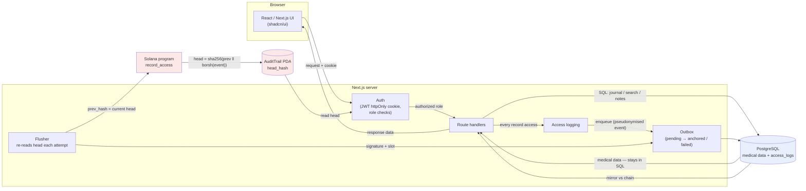

# Data Flow

Two tracks that must not be conflated: **medical data (SQL)** and the
**access log (Solana)**. Medical data is read from and written to PostgreSQL
and never leaves it. Each read also enqueues an access event, which a
background flusher commits to the program.

## What is stored where

| Data | Store | Notes |
|---|---|---|
| Users, patients, records, notes | PostgreSQL | Medical data. Never on chain. |
| Access event (who/what/when) | PostgreSQL `access_logs` | The durable outbox row and the off-chain mirror |
| Rolling head hash, event count | Solana `AuditTrail` PDA | 82 bytes, one global trail |
| Solana `slot`, `signature`, `head_hash` per event | PostgreSQL `access_logs` | Filled in once anchored; makes the mirror auditable |

## Pseudonymisation

Patient and user ids are salted and hashed (`ACCESS_HASH_SALT`, 32-byte hex)
*before* they are encoded into the 83-byte on-chain event. The chain therefore
holds pseudonymous accountability — enough to prove an entry was not altered,
not enough to link an entry back to a named person from the chain alone.
