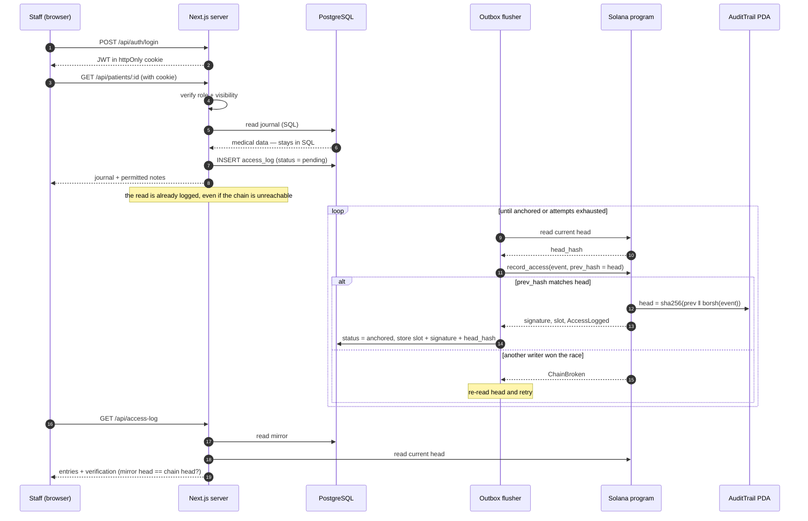

# Sequence: Permitted Read → Outbox → On-chain Anchor

An authorized user opens a record on server 1. Medical data is fetched from
PostgreSQL and stays in SQL. The access is written to the durable outbox, then
a background flusher commits it to the Solana program. Once anchored, the
off-chain mirror carries the `slot`, `signature`, and `head_hash`, which
`/api/access-log` can compare against chain state.

## Why the retry loop matters

Two servers write to one global `AuditTrail`. `record_access` is optimistic
concurrency: the transaction fails with `ChainBroken` if `prev_hash` is not the
current head. The flusher therefore re-reads the head on **every** attempt — a
blind retry with a stale `prev_hash` would fail identically forever.
