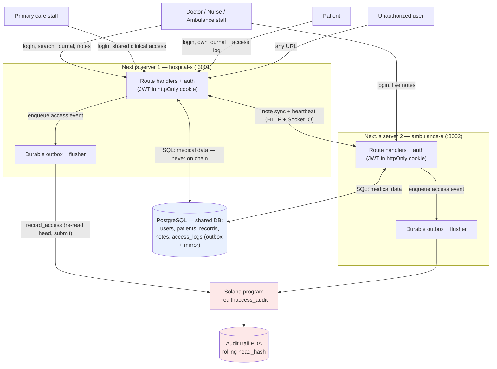

# System Context

HealthAccess runs as **two fullstack Next.js servers** (e.g. hospital-s and
ambulance-a) that share one PostgreSQL database for medical data. Each access
to a record is committed to a **Solana program** that keeps a single rolling
hash of the access log; no medical data ever reaches the chain.

## Actors

| Actor | Can | Cannot |
|---|---|---|
| Doctor / nurse / ambulance | Search patients, read journals, write notes per visibility | Read without leaving an access event |
| Primary care | The same clinical access as other staff | — |
| Patient | Read their own record and its access log | Read any other patient; edit notes |
| Unauthorized | Log in and hit protected routes | Reach protected resources (denied, and the denial is logged) |

The chain is deliberately **not** an authorization layer. Roles and access are
checked in the Next.js layer; the program only guarantees the log is
append-only.
