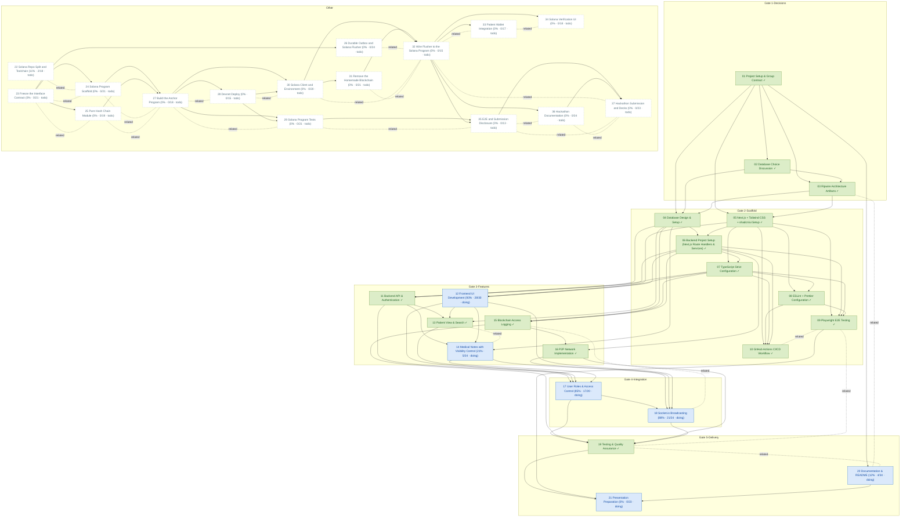

# Task Dependency Graph

_Auto-generated from the draft tasks in `docs/draft_tasks/`. Do not edit by hand._

Open in **[Mermaid Live](https://mermaid.live/edit#pako:eNqNWN1u2zgWfpUDFy1cbNOYpCTLXmABJ07bANMZb5KZArvdC1qibU5k0dBPMtnBPMXe7nvM_TzKPsmeI0u0TDPp-Mbwx_Mdnp9Ph7R-HSQmVYPpYJWZx2Qjiwru5l9zwM_r13BrMp2CLArzCDM4O_sbXEzhAlK1U3lagskRHS4zk9yrFJZPMHtrqXNTVQhmOldEfQ-FyiQh78_IyQxknqIrWahuxVIvTWaKcgrrQqkcUoMe_vgdllmtQOewKwwulCVhqSw36HJdyCeoTGpgmJsKygrTUGkbS1kvcX23wagTXWqTl__8OviIGwI7m3fQ18G_9tZ3I4bLIwaLwvyskgpuVVXv4A18LAx-X5q8KiTC__vvf3ocThwOc1nJpSwVXG6MThTMdZnUJW3g2AuyF3Cjd48aCzArko2ucLe6-VHpFW5RHnGw3k46ZSJXK5OlXTb87LZFehsFtFFwCGyuSr3OMZ19WsdRhWQcwvfql-r9zyX8Be6kzh419uny9hZ_lhuZJvl5rb3siNgRXEgUA1KO6zfsnN6YGmP9hM3PVFE2gRQPWKvyreNuTO7GcPe0U7dJoXfoqSo0OsQWrPS6LmR1WteYSDFc3X6n8wojXhSqqrQqXiRNiDSBRSafHgu93lRwxa_gTpWVztfHtmyEtmwEH3X1qV7CLCF3JVxen1_O4Ysp7ukp-kbfVkpSn60KxdmHFuntQyJkzBZztrjGUs3qaqPySieeLBhJkHH4UKBCifLjNTb7QWVmt0UODCfiNT0xPD4Xo-bRMZjd254D0iQTsEDnRPhJq8emPRLF6exFqmIBfFYpxpLB96ZSJTzqaoOsUi91pqun_aNiMhhy1uwcnvPAuzHJjoVwQWMEJxA-4rMkoQf8O7Nen7aAdMYiWPAFKrV6xKLD9XaXKUrztDCn9UdlqPVeCF0LgrPrA9jbijTIxvBjiQq6MZkivbax2ezisMmOjc-5v66kSRbjKMVWVu-1gYvC4HMk9_IaxvG-L8xfntP4U5XpB1U8dcGHOMX2SG9T0jSbWBG_gb_XsunKrCzxKchxOB1VlZOwMYG5SepDId_AzdVs_vkKhow3UQbnwttDTnrlNDRVadn4YyfbJ244avijcy7-VJIGlV6gzx_ou7cPqZxzOpdkLuFG7Qzc7jCx5jS5MybbC2jI9prj51h5_KazoR8uaR0j-YAHzL8V4B5AAihw7KrDiD_EzHw-6CHAlrWhLOhUklvoZvC32CR6HsKCJv4nPMXwyKDAP5u0ztSBjD30kOkR4BHMsZNLtP6hrpbml6YEbTQfshoPxqIXRODzQ_rmY7ioNQZMVZjlycYUNplDGN4qkrJ5TGMmVxV-7TLz1OOEPg4Jk0_cqpFOy2-UTJBEcXa11MusGVOU9FX-oHHs7eec9THy-SCdCobC2ZqHfeM_ma3aylT15883AiERCg5f6OjuKl2ZxpuT18vFECRDcRi5X2SWYSF7s6jnYOxzQBoUVoM_qUKvutMB5__L7RMkQRE2h10jnXq51fvLCt1bMlOSNg8-hM8HKVFEqODkXlYboh4NkJf1J0h_Ytxj92KgkPB6dl-6s-PYiR0deHFrLqh4GXMBYa9pLtBZBK6FBYQLdJTQtbBA0AKRvVc9B4zt3ckFOovYXodcoLOYuD4mLsUCsQu0PtjIsTgAYxeIXKDNljGXwlwKc7flLoW7FO7uIuwFyQW4A1hK4FIClxK4lNANLHQDC-3lpQUi1yJytx2721pAuEDgAl0csWthgcgFuAt0PiZu6BPXhwViB-jEz0f2ntECtrcugGPYAdpseeACoQtE9qhtgbE9PV2gTY7HLjCxh5ULtBZi5FhYQLShC2ZPjxbgroUF2qoL4QI227ZAInQtToDIDuoWGNup6wA0g47-YB86RA05XmIvLE16knSWgp5snKW4p4ZnwsA7m7vU7_-fXwp7mnCW-up4bilyl2zrSA8OK35-qS8rx-Go12lnKezp5pkwSGPPLZ3U8EhmzpIVy0kNrRbFSaGONPecw-i5pSSTZTlXq_0rm5XOsumrNFFpEr8r8c_SvZq-CsN4yVfvEnrDM33FlqHqJNIj0z-Wlr1Uk9XSslkYhcmoY4_SYCyZw27eAu3Jq-ZjycvRUiVhRw6DSI1lu3hG75HwLZd8moYQ9Dw2I4-y-esxyH2g8IGBDwx9YOQDxz4w9oETD4hvKjygLyPG93V3UF9KLPCa-nJivpzY2MuPvagvKz7ymXLmRXmjCAcUPjDwgaEPjHzg2AfGPnDiAXEieEDmA30ZCV9GwpeR8GUkfBkJm9Hg3WBd6HQwrYpavRtsVbGV9HPw62-4tJP5P4zZdqv4mnS9GUxXMivxV71LcUzMtaS_Q3uT3_4PNF10Zw)** (pako/zlib-compressed, verified to round-trip).

Regenerate whenever task metadata changes:

```bash
python3 -m project_management plan graph --output docs/diagrams/task-dependencies.md
```

## Legend

| Symbol | Meaning |
|---|---|
| `A --> B` (solid arrow) | B depends on A — B is **blocked by** A |
| `A -. related .- B` (dotted line) | A and B are **related** (soft link, not a dependency) |
| 🟢 green node | task **done** (marked ✓) |
| 🔵 blue node | **in progress** |
| ⬜ dashed-gray node | **todo** — not started |
| `(50% · 3/6 · doing)` | checkbox progress: 3 of 6 task boxes ticked, then the status |
| `(0/0 · todo)` | no checkboxes written yet — the checklist itself is still to be made |

Nodes are grouped into **Gate** subgraphs when tagged (`gate:1-decisions` …
`gate:5-delivery`). Tick `- [x]` boxes in the draft task files as the work
happens, then regenerate this diagram to update the percentages.


