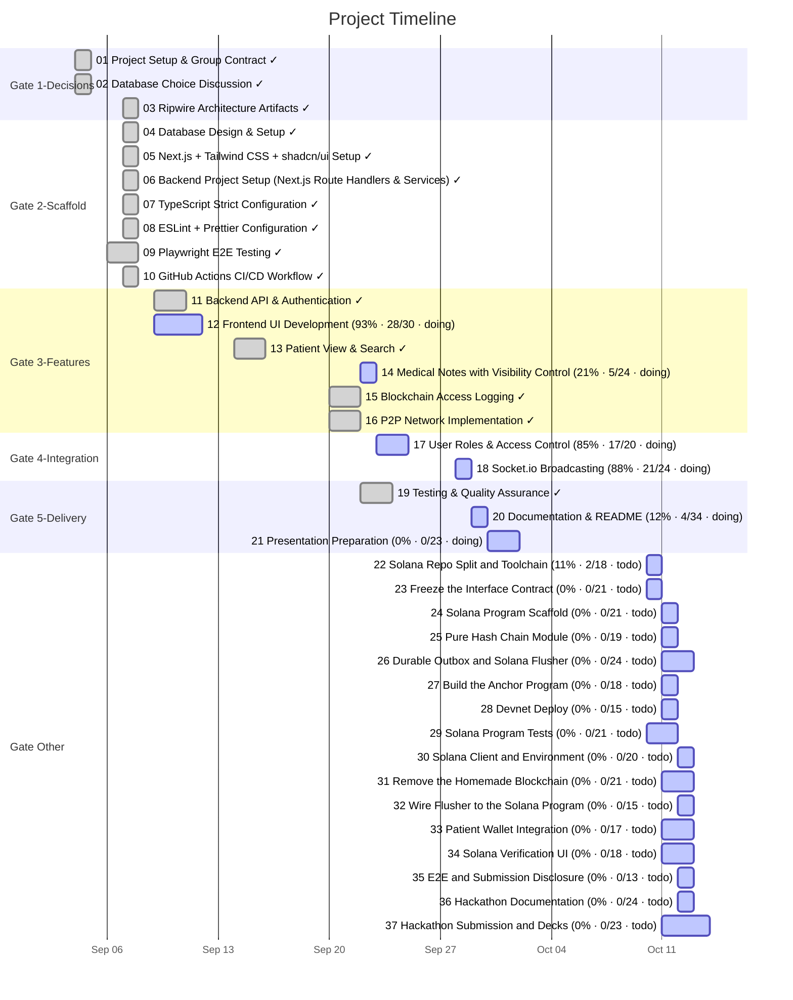

# Task Timeline (Gantt)

_Auto-generated from the draft tasks in `docs/draft_tasks/`. Do not edit by hand._

Open in **[Mermaid Live](https://mermaid.live/edit#pako:eNqVVttu2zgQ_ZWBgQQuNq4lyte8OZZzAZrWG6cNdtEXWqItNpQokJSdbNGv2Nf9j773U_ZLdijZkpJNbMcwINMUz5yZOTPD741Ahqxx2ljSxJivCeDHcCMYTJX8xgIDtzxmgies2AupYedSxdQA_IGf1vV1y_eLPfrA9XbvaA5H4dek2NCIw2UCF3gY3JbPAq5xrYtdxy1tzZjJUjiGCyXxOZaJURT__vefv-EUQpmwEyAO6bWcYcvpnIAbbhAI-NTQOdUMxpHkAQOf6yDT1sr-0x7c8HTNFYORCiJukEmWLwxfoHn9MkK_QnjiH2nNArpYSLGF71TkfKb5MkEHC0f34Tpd-MgezPtvGn6DW8rFmichjGczXOqIhkHSzvihWD04o8E9Q4Cn0W5uTdzIDOlf0iQUTOmcpFphLPW7_eB9uH1M2SxQPEVcozjCY_oWfJkpal7NQh1iAJPZB54Y9G2qmDGcqbdCDGEq6ONa8WVkYEImcMu04cny5ZM9_L056Tpwwc1lNodRnkkN46v22Ic7qe4XQq7fpgCvdc6oldBG4K5bhn40vcLAjjITscTwYIdfwxo7AucKa8ECfL5CEa2YkGmMCNAcekfw6yeQQdtz7I9Qor_vEA6Fy1fPAL0toAdTNG0BvnC2zlNNUfovMnE7NSYduGYh8hbwURqmYc1NhBiaz7ng5rEoWSmgSdycV7dNOjtpEVIF0e3CmZDBfRBRnmAmUHoaPsjl8rUUEqdGrQdTMsV6MWtMGlzFqWA2RK-HuH76Sf46rSsM9rJQ3Qa9D581CvJGCmZLY0OudHfQzd11-22yOw3Eq1EewAzdZeY9l3CmJBY0LfTaHAyKtLp74zd4RYRdbLMCX1WPG2PDshqO4feM5ukaaY3FlWC_fDFApOKKbvkyyKqIHsPNZORfT6Dpkpxrp-3toTqsqBLb85ku0XCR0k2ZN50cz2kTbyee91r-PmF1qY0dgiEWNKFww1IJsxTdBuxwcCulKHTWdAupkjbmA59GhvJ_5lwHvzX6HlYkY38xQFNg1aJwUrBqYlU-uAdjdrZUsT-j-GLYzpGD0dwaWhemdohdUh3hTLSOXssww7legqEiDgXrgY86mePpT5mZy4c8hBu25yLTGO8ayc4-3FJUfTjLODpoozhKgkiq0vmK5uBgmgPbGxNm8JEK-VjD6B6MMXyeBVs1-i0J3XqHDXkDNRZ5r7VBmyQrjr28aN4lprMTs9YiPReFHMtVIbxLGbOYhqzeNt-glZIogTt7-9lm0sgc_VkcDg1mnW01Z-6oEJiYWmOtAfYPZlrWyBem-GI7QHEovkEuJVg3vyPkUs7mMS9ui_biKKS2tVNhegd73MOKC-6piSzUk4Z5aH3U0fo1tBpHSxkv0ff6ea_c5bYd_o2TxlLxsHFqVMZOGjHDy7pdNr7_wK2UJn9KGW938Q6-jBqnCyo0rrLUXv19Tq0Yild-_AewobpC)** (pako/zlib-compressed, verified to round-trip).

Regenerate whenever task metadata changes:

```bash
python3 -m project_management plan gantt --output docs/diagrams/task-gantt.md
```

## Legend

| Bar | Meaning |
|---|---|
| `✓` task | **done** — rendered in the mermaid `done` style |
| plain task | **active** — scheduled work (or in progress) |
| `(50% · 3/6 · doing)` | checkbox progress + status, same format as the dependency graph |

Same design as the dependency graph: every task ends on its deadline (or on the
earliest deadline of the tasks that depend on it); duration comes from the
Estimated Effort. Tasks are grouped into Gate sections. Tasks with no usable
date cannot be drawn as a bar — they are listed under the chart until they get
a **Deadline**. (Mermaid gantt has no 'skipped' row state.)


