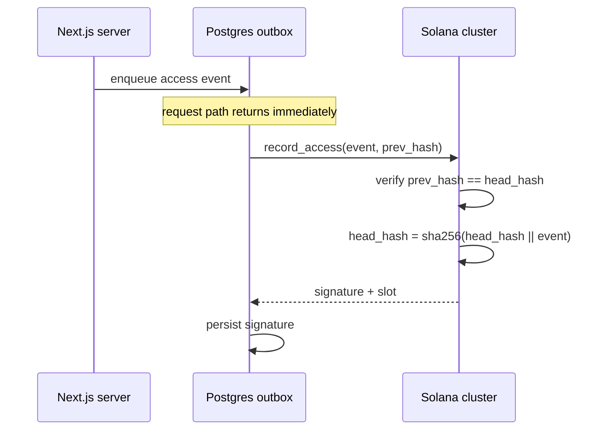

# Task: Solana Program Scaffold

## Metadata
- **Priority:** P0 - Critical
- **Deadline:** 2026-10-11
- **Status:** TODO
- **Assignee:** matdevstamp
- **Tags:** solana, rust, anchor, scaffold, required
- **Dependencies:** 22-solana-repo-split-and-toolchain.md
- **Related:** 24-solana-audit-program.md
- **Estimated Effort:** 4h

## Requirements

- An Anchor program `healthaccess_audit` exists with correct account layout
- The on-chain account structure is defined and frozen before any logic is written
- The access-event payload type is fixed-size, Borsh-serializable, and carries no personal data
- Instruction bodies are stubs; this task implements NO logic
- The IDL generates successfully

## User Stories

- As a builder, I want the account layout fixed before logic so that the data model does not churn during implementation
- As a builder, I want stubs rather than working code so that task 24 has an unambiguous starting point
- As a reviewer, I want to see the payload encoding so that I can verify the privacy boundary holds by construction

## Design

This task is deliberately **structural only**. Done-criteria below are all shape, never behavior. Task 24 adds all logic.

### Account

```rust
#[account]
#[derive(InitSpace)]
pub struct AuditTrail {
    pub version: u8,
    pub authority: Pubkey,   // organization admin
    pub head_hash: [u8; 32], // rolling commitment
    pub event_count: u64,
    pub bump: u8,
}
```

Single global PDA, seeds `[b"audit_trail"]`. One trail for the whole system. Per-organization trails were considered and deferred: they multiply account count and contention analysis for no demo gain, and it is a good design question to raise at the Build Station rather than to build.

### Payload: the privacy boundary

```rust
#[derive(AnchorSerialize, AnchorDeserialize, Clone)]
pub struct AccessEvent {
    pub patient_hash: [u8; 32],  // salted hash, NOT the patient ID
    pub actor_hash: [u8; 32],    // salted hash, NOT the user ID
    pub action: u8,              // enum: view, create, edit, delete, view_denied
    pub role: u8,                // enum: doctor, nurse, ambulance, primary_care, patient, unauthorized
    pub record_id: i64,          // -1 when not applicable
    pub server: u8,              // server instance index
    pub timestamp: i64,          // client-supplied; chain slot is the trusted clock
}
```

Constraints, all deliberate:

- **No `String`, no `Vec`.** Fixed size only, so the payload is bounded and cannot leak arbitrary content.
- **IDs are salted-hashed client-side.** The chain holds pseudonymous accountability, not linkable identity.
- **No names, dates of birth, personal numbers, or note content.** Ever.
- `record_id: i64` with `-1` sentinel rather than `Option`, to keep Borsh encoding fixed-length.

### Instructions (stubs only)

```rust
pub fn initialize(ctx: Context<Initialize>) -> Result<()> { todo!() }
pub fn record_access(ctx: Context<RecordAccess>, event: AccessEvent, prev_hash: [u8; 32]) -> Result<()> { todo!() }
```

### Errors

```rust
pub enum AuditError {
    Unauthorized,
    ChainBroken,      // prev_hash != stored head_hash
    AccountAlreadyInitialized,
}
```

### Sequence



## Tasks

- [ ] Create `programs/healthaccess_audit/src/lib.rs`
- [ ] Define `AuditTrail` account with `InitSpace`
- [ ] Define `AccessEvent` payload with the constraints above
- [ ] Define `AuditError` enum
- [ ] Define `initialize` and `record_access` account contexts
- [ ] Declare both instructions with `todo!()` bodies
- [ ] Wire `Anchor.toml` with the program name and devnet cluster
- [ ] Confirm `anchor build` generates the IDL, or document the failure

## Done Criteria

- [ ] `programs/healthaccess_audit/src/lib.rs` exists and compiles as a workspace member
- [ ] `AuditTrail` has exactly the five fields listed above
- [ ] `AccessEvent` contains no `String`, no `Vec`, and no personal-data field
- [ ] Both instruction bodies are `todo!()` stubs
- [ ] IDL is generated, or generation failure is documented with its error
- [ ] NO instruction contains hash arithmetic or state mutation logic

## Notes

- If `AccessEvent` needs a discriminator, prefer a numeric enum over a string enum: strings in a fixed-size account invite variable-length encoding
- Keep `version: u8` from day one; migrating account layout later requires a redeploy

## Questions to Resolve

- [ ] Should the payload carry an `event_id` (UUID bytes) for correlation with Postgres, or is `slot + sequence` sufficient?
- [ ] Salt source for the patient/actor hashes: per-deployment random secret, or per-patient secret? Per-deployment is simpler and prevents cross-deployment linkage