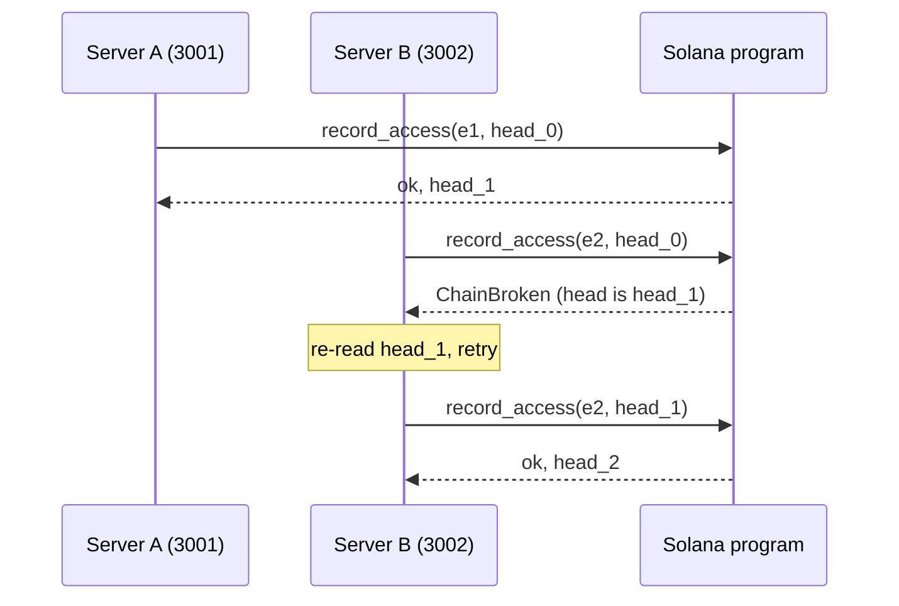

# Task: Build the Anchor Audit Program

## Metadata
- **Priority:** P0 - Critical
- **Deadline:** 2026-10-11
- **Status:** TODO
- **Assignee:** matdevstamp
- **Tags:** solana, rust, anchor, blockchain, required
- **Dependencies:** 23-solana-program-scaffold.md
- **Related:** 26-solana-program-tests.md, 25-solana-devnet-deploy.md
- **Estimated Effort:** 12h

## Requirements

- `initialize` creates the `AuditTrail` PDA with a zeroed head hash
- `record_access` appends an event by chaining the hash into the stored head
- Only the trail authority may append
- A caller supplying a stale `prev_hash` is rejected rather than allowed to fork
- Appends are O(1) and emit an event for off-chain indexing
- The hash-chain core is a pure Rust module testable without any Solana dependency

## User Stories

- As a patient, I want my access log committed to a public chain so that nobody can quietly remove it
- As an auditor, I want each entry to commit to its predecessor so that a missing entry is detectable
- As the system, I want appends to cost constant work so that a long history does not slow down logging
- As a builder, I want the hash logic in a plain Rust module so that I can test it before the Solana toolchain is ready

## Design

### Pure core, thin wrapper

The critical scheduling decision. `sha256(prev_hash || event_bytes)` is pure computation with no Solana types in it, so it lives in its own module:

```
programs/healthaccess_audit/src/
├── lib.rs              # Anchor entrypoints (thin)
├── hash_chain.rs       # pure: chain_head(), verify_chain()
└── state.rs            # pure: AccessEvent encoding
```

`cargo test` runs `hash_chain.rs` with zero Solana tooling installed. If the Anchor CLI install fails or stalls, the hardest logic is still verified on day one. The Anchor layer only adds account constraints and state writes.

### Why the hash chain, if the chain is already public?

Solana transactions are individually immutable, but there is no *ordering* guarantee across accounts, and no way to prove a log entry was never omitted. The rolling head hash closes that gap: if someone drops entry N from the Postgres mirror, recomputation from `head_hash` fails.

The honest limit, worth stating in the pitch before a judge asks: **this prevents retroactive alteration of the log; it does not stop a malicious server from logging a lie in the first place.** The app's own authorization layer is still trusted to produce truthful events. Overclaiming here is the easiest way to lose a technical judge.

### record_access

```rust
pub fn record_access(
    ctx: Context<RecordAccess>,
    event: AccessEvent,
    prev_hash: [u8; 32],
) -> Result<()> {
    require_keys_eq!(
        ctx.accounts.trail.authority,
        ctx.accounts.authority.key(),
        AuditError::Unauthorized
    );
    require!(
        ctx.accounts.trail.head_hash == prev_hash,
        AuditError::ChainBroken
    );

    let next = hash_chain::chain_head(&prev_hash, &event);

    ctx.accounts.trail.head_hash = next;
    ctx.accounts.trail.event_count += 1;
    let seq = ctx.accounts.trail.event_count;

    emit!(AccessLogged {
        seq,
        head_hash: next,
        slot: Clock::get()?.unix_timestamp,
        ..event
    });

    Ok(())
}
```

### Optimistic concurrency

`prev_hash` is passed as an argument and checked against the stored head. Two writers racing produce exactly one winner; the loser gets `ChainBroken` and must re-read the head and retry. This replaces the old design's implicit last-write-wins timestamp sort.

Old behavior, for contrast: `blockchain.ts:11-42` collected all entries, re-sorted the entire chain, and rebuilt every block on each insert. O(n log n) per write, unbounded growth, and no detection of a stale writer.

### Flow with two servers



That rejection is correct behavior, not a bug, and it is a good demo beat.

## Tasks

- [ ] Implement `hash_chain::chain_head(prev, event)`
- [ ] Implement `hash_chain::verify_chain(events, expected_head)`
- [ ] Implement `initialize` with `init` + seeds + bump
- [ ] Implement `record_access` per the sequence above
- [ ] Emit `AccessLogged` with sequence and head hash
- [ ] Use canonical Borsh encoding for the hash input
- [ ] Return typed `AuditError` variants, never strings
- [ ] `cargo test` green on `hash_chain.rs` with no Solana installed

## Done Criteria

- [ ] `cargo test` passes for the pure module with no Solana CLI present
- [ ] `initialize` creates the PDA with `head_hash = [0u8; 32]`
- [ ] `record_access` updates `head_hash` and increments `event_count`
- [ ] Non-authority signer is rejected with `Unauthorized`
- [ ] Stale `prev_hash` is rejected with `ChainBroken`
- [ ] `AccessLogged` event is emitted with `seq` and `head_hash`
- [ ] Hash input uses canonical Borsh bytes, not ad-hoc string concatenation
- [ ] No instruction panics; all failure paths return `Result::Err`

## Notes

- Hash input must be deterministic across client and program; canonical Borsh avoids the classic "same logical value, different bytes" bug
- `Clock::get()` requires the `sysvar` import and a declared account in the context
- Store `bump` in the account to avoid recomputing it on every access
- Keep compute units low: the whole point is that logging is cheap

## Questions to Resolve

- [ ] Should `record_access` enforce a max `event_count` or a max payload age?
- [ ] Is emitting the full `AccessEvent` on-chain acceptable, or should only the hash be emitted with detail read from Postgres?
- [ ] Do we want a `close` instruction for decommissioning, or is immutability absolute?