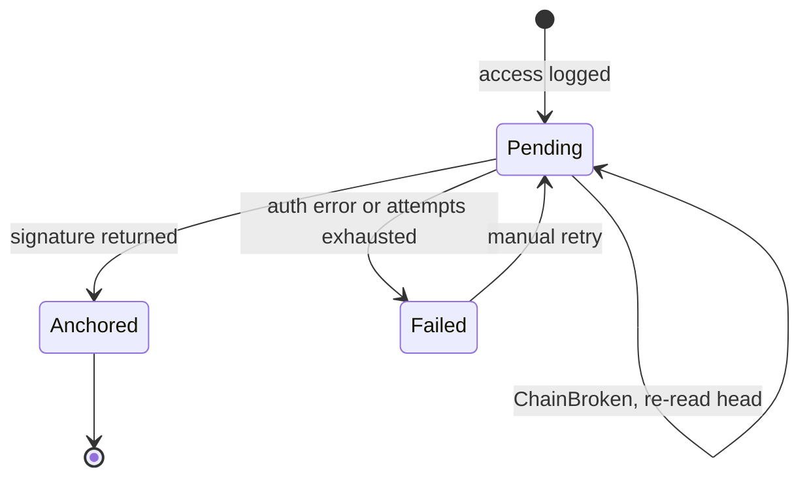

# Task: Durable Outbox and Solana Flusher

## Metadata
- **Priority:** P0 - Critical
- **Deadline:** 2026-10-12
- **Status:** TODO
- **Assignee:** matdevstamp
- **Tags:** solana, backend, architecture, required
- **Dependencies:** 23-freeze-interface-contract.md
- **Related:** 32-wire-flusher-to-program.md
- **Estimated Effort:** 9h

## Requirements

- Recording an access event never blocks the request that triggered it
- The event is durably persisted before any network call is attempted
- A background flusher submits pending events to Solana
- A rejected write retries with a RE-READ of the current head hash, never blind-retried
- Events survive process restart
- The flusher is mockable so it can be built and tested before the program is deployed

## User Stories

- As a patient, I want viewing my record to stay fast so that audit logging does not degrade my care experience
- As an auditor, I want no access event lost if the server crashes mid-request so that the log has no gaps
- As the system, I want two servers writing concurrently so that neither node is a single point of failure
- As a builder, I want retries to re-read chain state so that contention does not drop events

## Design

### Why an outbox

The obvious approach awaits `sendTransaction()` in the request handler. That
makes every patient record read wait on a cluster round trip, and a slow drop
means a missing audit entry.

The outbox splits the two:

```
request handler   →  INSERT into access_log (status=pending)  →  return
background flusher →  SELECT pending → submit to Solana → UPDATE with signature
```

The outbox row is written in the same transaction as the audit row, so an event
cannot exist without being durable. This revives the currently-dead `AccessLog`
Prisma model (`prisma/schema.prisma:125-140`) for real work.

### Split for parallelism

This task runs in wave 1, before the program is deployed. The **outbox half**
(Postgres model, insert path, state machine, retry classification) needs only
the types from the contract, not a live program.

The flusher talks to a narrow interface:

```ts
interface ChainSubmitter {
  fetchHead(): Promise<[u8, 32]>;
  submit(event: AccessEvent, prevHash: [u8, 32]): Promise<string>;
}
```

A mock implementation lets the state machine, retry, and backoff all be tested
in wave 1. Task 32 swaps in the real Anchor-backed submitter. That is what makes
this task parallel with the scaffold and hash chain rather than after them.

### Retry with re-fetch

The part that is easy to get wrong, and is a done-criterion as a test:

```ts
async function flush(entry: OutboxEntry): Promise<void> {
  for (let attempt = 0; attempt < MAX_ATTEMPTS; attempt++) {
    const head = await submitter.fetchHead();   // RE-READ every attempt
    try {
      const sig = await submitter.submit(entry.event, head);
      await markAnchored(entry.id, sig);
      return;
    } catch (err) {
      if (!isChainBroken(err)) { await markFailed(entry.id, err); return; }
      await sleep(backoff(attempt));             // contention: re-read, retry
    }
  }
  await markFailed(entry.id, "contention");
}
```

A blind retry re-submits the same stale `prev_hash` and fails identically
forever. With two servers writing to one PDA this is the common case.

### State machine



### Model

```prisma
model AccessLog {
  id         Int      @id @default(autoincrement())
  eventId    String   @unique
  patientId  Int
  userId     Int
  recordId   Int?
  action     String
  serverId   String
  clientTime DateTime
  slot       BigInt?
  signature  String?
  status     String   @default("pending")
  headHash   String?
  attempt    Int      @default(0)
  error      String?
  createdAt  DateTime @default(now())
}
```

`status` replaces the unused `blockchainSynced` boolean with something real.
`attempt` and `error` make retry behavior observable instead of invisible.

## Tasks

- [ ] Add the `AccessLog` fields and write the migration
- [ ] Replace `blockchainSynced` with `status`
- [ ] Write the outbox insert into the access-logging path
- [ ] Define the `ChainSubmitter` interface
- [ ] Write a mock submitter for tests
- [ ] Implement `flush()` with re-read-and-retry
- [ ] Classify retryable versus terminal errors
- [ ] Add backoff and an attempt cap
- [ ] Make the flusher idempotent across restart
- [ ] Guard against two servers flushing the same row
- [ ] Test: RPC failure leaves the event pending, not lost
- [ ] Test: stale head triggers re-read, not permanent failure
- [ ] Test: restart resumes pending events

## Done Criteria

- [ ] Access logging adds no cluster round trip to the request path
- [ ] An event is durable in Postgres before any network call
- [ ] Pending events survive a server restart and are flushed
- [ ] `ChainBroken` causes a head re-read and retry, not a drop
- [ ] Auth errors fail fast and are not retried
- [ ] The flusher depends only on `ChainSubmitter`, so it is mockable
- [ ] A test covers concurrent writers resolving via re-read
- [ ] The outbox path compiles and tests green with no Solana dependency

## Notes

- Use a Postgres advisory lock, or `SKIP LOCKED`, so both servers do not flush the same row
- Keep pending rows out of any "verified" view; a queued row is not a record
- Do not let flusher failures surface in the user request
- Existing tests mock the blockchain singleton and will need rewriting in task 31
- Owns `prisma/schema.prisma` exclusively

## Questions to Resolve

- [ ] Flush on write plus a periodic sweep, or a fixed timer? The former gives snappy demo behavior without hammering devnet
- [ ] Retain pending events for how long before giving up?
- [ ] Batch multiple events per transaction to save fees, at the cost of per-event atomicity?