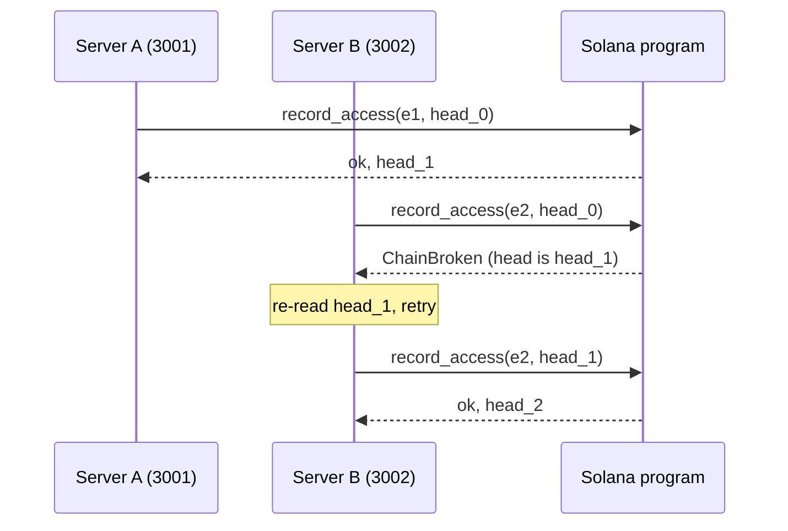

# Task: Build the Anchor Program

## Metadata
- **Priority:** P0 - Critical
- **Deadline:** 2026-10-11
- **Status:** TODO
- **Assignee:** matdevstamp
- **Tags:** solana, rust, anchor, blockchain, required
- **Dependencies:** 24-solana-program-scaffold.md, 25-solana-hash-chain.md
- **Related:** 28-solana-devnet-deploy.md, 29-solana-program-tests.md
- **Estimated Effort:** 5h

## Requirements

- `initialize` creates the `AuditTrail` PDA with a zeroed head hash
- `record_access` appends by chaining into the stored head
- Only the trail authority may append
- A stale `prev_hash` is rejected rather than allowed to fork
- Appends are O(1) and emit an event for off-chain indexing
- `lib.rs` contains no hash arithmetic; it delegates to `hash_chain.rs`

## User Stories

- As a patient, I want my access log committed to a public chain so that nobody can quietly remove it
- As the system, I want appends to cost constant work so that a long history does not slow down logging
- As an auditor, I want a signature per entry so that the log is attributable rather than merely self-consistent

## Design

### Thin wrapper, by construction

The previous chain had no signatures. `Block.hash` was recomputable by anyone
holding the data, so `isValid()` proved internal consistency, not authenticity:
an in-process attacker could rewrite a block and rehash it.

On Solana the transaction is signed by the fee payer and the program is the
only writer to the PDA. That is the improvement this project exists to make, and
it is why `lib.rs` is deliberately thin.

### record_access

```rust
pub fn record_access(
    ctx: Context<RecordAccess>,
    event: AccessEvent,
    prev_hash: [u8; 32],
) -> Result<()> {
    require_keys_eq!(
        ctx.accounts.trail.authority,
        ctx.accounts.authority.key(),
        AuditError::Unauthorized
    );
    require!(
        ctx.accounts.trail.head_hash == prev_hash,
        AuditError::ChainBroken
    );

    // Delegated. All hashing lives in hash_chain.rs (task 25).
    let next = hash_chain::chain_head(&prev_hash, &event);

    ctx.accounts.trail.head_hash = next;
    ctx.accounts.trail.event_count += 1;
    let seq = ctx.accounts.trail.event_count;

    emit!(AccessLogged {
        seq,
        head_hash: next,
        ..event
    });
    Ok(())
}
```

### Optimistic concurrency

`prev_hash` is an argument, checked against the stored head. Two racing writers
produce exactly one winner; the loser gets `ChainBroken` and must re-read the
head and retry. This replaces the old chain's implicit last-write-wins timestamp
sort.

Old behavior for contrast: `blockchain.ts:11-42` collected all entries, re-sorted
the entire chain, and rebuilt every block on each insert. O(n log n) per write,
unbounded growth, and no detection of a stale writer.



That rejection is correct behavior, and a good demo beat.

### Honest limit

This prevents retroactive alteration of the log. It does not stop a malicious
server logging a lie at write time. The application's authorization layer is
still trusted to produce truthful events. State this in the pitch before a judge
asks; volunteering a precise limitation reads as mastery.

## Tasks

- [ ] Implement `initialize` with `init`, seeds, and bump
- [ ] Implement `record_access` per the sequence above
- [ ] Delegate hashing to `hash_chain::chain_head`
- [ ] Emit `AccessLogged` with sequence and head hash
- [ ] Return typed `AuditError` variants, never strings
- [ ] Store `bump` in the account to avoid recomputation
- [ ] Confirm the IDL generates
- [ ] Verify the program builds

## Done Criteria

- [ ] `initialize` creates the PDA with `head_hash = [0u8; 32]`
- [ ] `record_access` updates `head_hash` and increments `event_count`
- [ ] Non-authority signer is rejected with `Unauthorized`
- [ ] Stale `prev_hash` is rejected with `ChainBroken`
- [ ] `AccessLogged` is emitted with `seq` and `head_hash`
- [ ] No hash arithmetic in `lib.rs`
- [ ] No instruction panics; all failure paths return `Result::Err`
- [ ] The IDL generates and is committed

## Notes

- **Owns `lib.rs` exclusively.** Do not edit `hash_chain.rs`, `state.rs`, or `errors.rs`; they belong to task 25
- Anchor is 1.2.1. Verify `declare_program!` versus `declare_id!` and the event API against installed docs before writing
- Keep compute units low. Cheap logging is a talking point
- Store `bump` in the account to avoid recomputing per access

## Questions to Resolve

- [ ] Should `record_access` cap `event_count` or payload age?
- [ ] Emit the full `AccessEvent` on-chain, or only the hash with detail in Postgres?