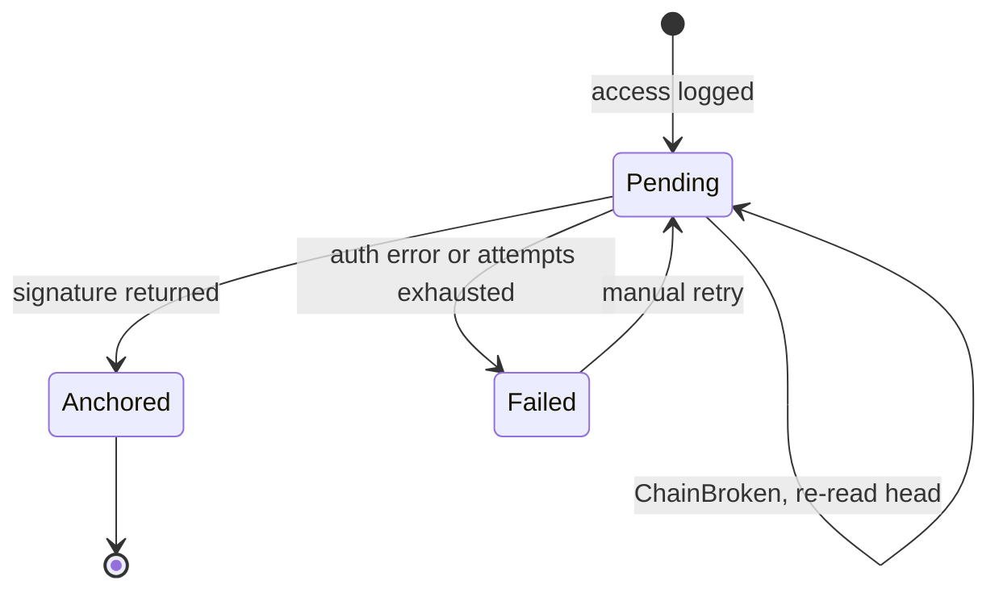

# Task: Durable Outbox and Solana Flusher

## Metadata
- **Priority:** P0 - Critical
- **Deadline:** 2026-10-12
- **Status:** TODO
- **Assignee:** matdevstamp
- **Tags:** solana, backend, architecture, required
- **Dependencies:** 24-solana-audit-program.md
- **Related:** 28-remove-homemade-blockchain.md
- **Estimated Effort:** 9h

## Requirements

- Recording an access event never blocks the request that triggered it
- The event is durably persisted before any network call is attempted
- A background flusher anchors pending events to Solana
- A rejected write is retried with a RE-READ of the current head hash, never blind-retried
- Events survive process restart

## User Stories

- As a patient, I want viewing my record to stay fast so that audit logging does not degrade my care experience
- As an auditor, I want no access event lost if the server crashes mid-request so that the log has no gaps
- As the system, I want two servers to be able to write concurrently so that neither node becomes a single point of failure
- As a builder, I want retries to re-read chain state so that contention does not cause dropped events

## Design

### Why an outbox rather than inline submission

The obvious approach is `await sendTransaction()` inside the request handler. That makes every patient record read wait on a cluster round trip (~400ms devnet, worse under load). A dropped view means a slow UI; a *fast* drop means a missing audit entry.

The outbox splits the two:

```
request handler          → INSERT into access_log_outbox  → return
background flusher       → SELECT pending → submit to Solana → UPDATE with signature
```

The write to Postgres is in the same transaction as the audit row, so an event cannot exist without being durable. That reuses the currently-dead `AccessLog` Prisma model (`prisma/schema.prisma:125-140`) for something real.

### Retry with re-fetch

This is the part that is easy to get wrong and must be in the done-criteria as a test:

```ts
async function flush(entry: OutboxEntry): Promise<void> {
  for (let attempt = 0; attempt < MAX_ATTEMPTS; attempt++) {
    const head = await fetchCurrentHead();   // RE-READ every attempt
    try {
      const sig = await program.methods
        .recordAccess({ event: toChainEvent(entry), prevHash: head })
        .rpc();
      await markAnchored(entry.id, sig);
      return;
    } catch (err) {
      if (!isChainBroken(err)) throw err;    // auth errors are not retryable
      await sleep(backoff(attempt));         // contention: re-read, retry
    }
  }
  await markFailed(entry.id, "contention");
}
```

A blind retry re-submits the same stale `prev_hash` and fails identically forever. With two servers writing to one PDA this is the common case, not an edge case.

### State machine



### Model changes

```prisma
model AccessLog {
  id           Int      @id @default(autoincrement())
  eventId      String   @unique
  patientId    Int
  userId       Int
  recordId     Int?
  action       String
  serverId     String
  clientTime   DateTime
  slot         BigInt?      // null until anchored
  signature    String?      // null until anchored
  status       String       // pending | anchored | failed
  headHash     String?      // chain head after this event
  createdAt    DateTime     @default(now())
}
```

`status` replaces the unused `blockchainSynced` boolean with something real.

## Tasks

- [ ] Add `AccessLog` fields: `slot`, `signature`, `status`, `headHash`
- [ ] Write the migration
- [ ] Add outbox insert to the access-logging path
- [ ] Implement `fetchCurrentHead()`
- [ ] Implement `flush()` with re-read-and-retry
- [ ] Classify retryable vs terminal errors
- [ ] Add backoff and an attempt cap
- [ ] Start the flusher from `instrumentation-node.ts`
- [ ] Make the flusher idempotent across restart
- [ ] Test: RPC failure leaves the event `pending`, not lost
- [ ] Test: stale head triggers re-read, not permanent failure

## Done Criteria

- [ ] Access logging adds no cluster round trip to the request path
- [ ] An event is durable in Postgres before any network call
- [ ] Pending events survive a server restart and are flushed
- [ ] `ChainBroken` causes a head re-read and retry, not a drop
- [ ] Auth errors fail fast and are not retried
- [ ] A test covers concurrent writers resolving via re-read
- [ ] `AccessLog.blockchainSynced` is removed in favor of `status`

## Notes

- The flusher must be safe under two instances; consider a Postgres advisory lock so both servers do not flush the same row
- Keep the outbox table separate from the audit view so pending rows are never shown as verified
- Do not let flusher failures surface in the user request; they are background concerns
- Existing tests mock the blockchain singleton and will need rewriting in task 28

## Questions to Resolve

- [ ] Flush interval: fixed timer, or immediately-on-write plus a periodic sweep? The latter gives snappy demo behavior without hammering devnet
- [ ] Retain pending events for how long before giving up?
- [ ] Should the flusher batch multiple events per transaction to save fees, at the cost of atomicity per event?