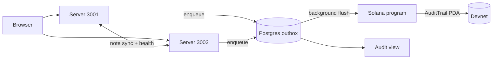

# Task: Hackathon Documentation

## Metadata
- **Priority:** P0 - Critical
- **Deadline:** 2026-10-12
- **Status:** TODO
- **Assignee:** matdevstamp
- **Tags:** documentation, disclosure, required
- **Dependencies:** 29-solana-client-and-ha-demo.md
- **Related:** 32-solana-e2e-and-disclosure.md, 33-hackathon-submission-and-decks.md
- **Estimated Effort:** 5h

## Requirements

- The README describes the Solana architecture, not the removed homemade chain
- Setup instructions work from a clean clone on a machine with no `.env`
- The program ID, deployment command, and devnet cluster are documented
- Architecture diagrams match the implemented system
- The origin and prior-work disclosure are stated plainly in the README
- No document claims a capability the code does not implement

## User Stories

- As a judge, I want the README to explain the architecture so that I can evaluate the engineering without reading the code
- As a builder, I want setup steps I can follow from scratch so that a fresh clone runs
- As a judge, I want the origin disclosed so that I can judge prior work fairly
- As a reader, I want diagrams that match the code so that I do not waste time on stale documentation

## Design

Documentation is a judged artifact here. Colosseum reviews the repository directly, and inconsistent docs cost credibility faster than missing features.

### README structure

| Section | Content |
|---|---|
| Title + one-line pitch | What it is, in one sentence |
| Problem | Patients cannot verify who accessed their records |
| How it works | Anchor program, rolling head hash, outbox, Postgres mirror |
| Architecture diagram | Rendered Mermaid, current topology |
| **Origin** | Course-project origin and prior work, stated plainly |
| Quick start | Clean-clone setup |
| Program details | Devnet program ID, deploy command, cluster |
| Testing | How to run unit, LiteSVM, and E2E suites |
| Demo | Link to the demo video, or the flow outline |

### The origin disclosure

Short, factual, near the top. Not an apology and not buried:

```markdown
## Origin

This began as a course project (Inl 3) built on a custom in-memory hash
chain. That implementation is preserved in the git history. The Solana
program, its tests, and the audit pipeline were built during the
Colosseum Crypto World's Fair hackathon.
```

The history is public and the rules require disclosure, so the disclosure
should read as confidence rather than damage control. The same facts go in
the submission form, stated more completely.

### Corrections to existing docs

Three categories, and they must not be conflated:

**Became true after this project** (keep, and they are now accurate):

| Location | Claim |
|---|---|
| `demo/captions.ts:70` | blocks are hashed and signed |
| `docs/diagrams/data-flow.md` | "append access-log (hash + signatur)" |

**No longer true, must be rewritten:**

| Location | Old claim | New |
|---|---|---|
| `demo/captions.ts:88` | signing over chain-P2P | chain sync is gone; access logs go to Solana |
| `README.md:36` | custom chain implementation | Solana Anchor program |
| `docs/api/README.md:140-206` | `/api/p2p/access-log`, `chainValid` | deleted in task 28 |
| `docs/database.md:136-153` | old `AccessLog` fields | `slot`, `signature`, `status`, `headHash` |
| `docs/PROJECT_PLAN.md:110` | Stream D contract: append-only log payload | superseded by the on-chain trail |

**Was suggested by the course, never built** (must be labeled as such):

`docs/Raw_Requirements.md:112-127` suggests pub/priv-key signing, Merkle
trees, and mining. Signing is now implemented on-chain. Merkle trees and
mining remain unbuilt. Label them rather than deleting them, so a judge
comparing against the brief sees the gap acknowledged rather than hidden.

### Diagrams

Regenerate for the actual topology:



Files to regenerate in `docs/diagrams/`: `system-context.md`,
`data-flow.md`, `data-model.md` (generated from Prisma; regenerate via
`prisma generate`), and `sequence-access-log.md`.

### Clean-clone verification

The test that this task is actually done:

```
git clone <repo> && cd healthaccess-solana
npm ci
npm run db:up && npm run db:migrate && npm run db:seed
npm run dev
```

Verify the app boots, login works, and a record view produces an anchored
access log. If any step needs something not in the README, the README is
incomplete.

## Tasks

- [ ] Rewrite the README for the Solana architecture
- [ ] Add the origin and disclosure section
- [ ] Record the devnet program ID and deploy command
- [ ] Document `SOLANA_*` environment variables
- [ ] Document the devnet keypair setup path
- [ ] Regenerate `docs/diagrams/` for the new topology
- [ ] Regenerate `docs/diagrams/data-model.md` via `prisma generate`
- [ ] Correct `demo/captions.ts` at lines 70 and 88
- [ ] Update `docs/api/README.md` for the deleted P2P routes
- [ ] Update `docs/database.md` for the new `AccessLog` fields
- [ ] Mark tasks 15 and 16 superseded
- [ ] Label Merkle/mining as unbuilt in `Raw_Requirements.md`
- [ ] Audit every doc for claims the code does not support
- [ ] Verify setup from a clean clone
- [ ] Add documentation link to task 33's deck footer

## Done Criteria

- [ ] README describes the Solana architecture end to end
- [ ] Program ID, cluster, and deploy command are documented
- [ ] All `SOLANA_*` variables documented with defaults
- [ ] Origin disclosure present and accurate
- [ ] Diagrams match the implemented topology
- [ ] No doc claims unbuilt capability without labeling it as such
- [ ] Setup verified from a clean clone
- [ ] Deleted P2P routes are no longer documented

## Notes

- This task is **not** droppable, unlike the UI polish in task 31. Judges read the repo, and stale documentation reads as carelessness
- `data-model.md` is generated by `prisma generate` via `prisma-erd-generator`; never hand-edit it
- Update task 22's toolchain baseline in the same pass if the Anchor version differs from the assumed one
- The disclosure note is deliberately short. A long explanation invites scrutiny it does not need

## Questions to Resolve

- [ ] Should the course repo be archived with a pointer to this repo, or left untouched?
- [ ] Keep `gruppkontrakt.md` and the course logbooks in the fork, or remove them from the hackathon repo? Leaving them is honest; removing them reduces noise
- [ ] Should the architecture diagram be Mermaid in markdown, or a rendered image? Mermaid renders on GitHub and stays current