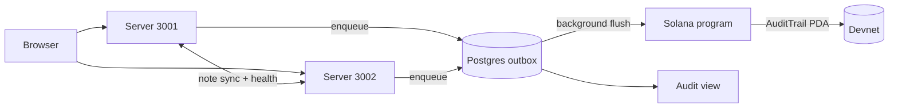

# Task: Hackathon Documentation

## Metadata
- **Priority:** P0 - Critical
- **Deadline:** 2026-10-12
- **Status:** TODO
- **Assignee:** matdevstamp
- **Tags:** documentation, disclosure, required
- **Dependencies:** 32-wire-flusher-to-program.md
- **Related:** 35-solana-e2e-and-disclosure.md, 37-hackathon-submission-and-decks.md
- **Estimated Effort:** 5h

## Requirements

- The README describes the Solana architecture
- Setup instructions work from a clean clone with no `.env`
- The program ID, deployment command, and devnet cluster are documented
- Architecture diagrams match the implemented system
- The origin and prior-work disclosure are stated plainly
- No document claims a capability the code does not implement

## User Stories

- As a judge, I want the README to explain the architecture so that I can evaluate the engineering without reading the code
- As a builder, I want setup steps I can follow from scratch so that a fresh clone runs
- As a judge, I want the origin disclosed so that I can judge prior work fairly

## Design

Documentation is a judged artifact. Colosseum reviews the repository directly,
and inconsistent docs cost credibility faster than missing features.

### Two phases

**Early phase (wave 0, no code needed):** the origin section, the problem
statement, the architecture outline. These describe a design already frozen in
`INTERFACE-CONTRACT.md`.

**Final phase (wave 6):** verify every claim against the running system,
regenerate diagrams, fix what drifted.

### README structure

| Section | Content |
|---|---|
| Title + one-line pitch | What it is, in one sentence |
| Problem | Patients cannot verify who accessed their records |
| How it works | Anchor program, rolling head hash, outbox, Postgres mirror |
| Architecture diagram | Rendered Mermaid, current topology |
| **Origin** | Course-project origin and prior work |
| Quick start | Clean-clone setup |
| Program details | Devnet program ID, deploy command, cluster |
| Testing | Unit, LiteSVM, E2E |
| Demo | Video link or flow outline |

### The origin disclosure

Short, factual, near the top. Not an apology, not buried:

```markdown
## Origin

This began as a course project (Inl 3) built on a custom in-memory hash
chain. That implementation is preserved in the git history. The Solana
program, its tests, and the audit pipeline were built during the
Colosseum Crypto World's Fair hackathon.
```

The history is public and the rules require disclosure, so the disclosure
should read as confidence rather than damage control.

### Corrections to existing docs

Three categories; do not conflate them.

**Become true after this project:**

| Location | Claim |
|---|---|
| `demo/captions.ts:70` | blocks are hashed and signed |
| `docs/diagrams/data-flow.md` | "append access-log (hash + signatur)" |

**No longer true, must be rewritten:**

| Location | Old claim | New |
|---|---|---|
| `demo/captions.ts:88` | signing over chain-P2P | chain sync gone; logs go to Solana |
| `README.md:36` | custom chain implementation | Solana Anchor program |
| `docs/api/README.md:140-206` | `/api/p2p/access-log`, `chainValid` | deleted in task 31 |
| `docs/database.md:136-153` | old `AccessLog` fields | `slot`, `signature`, `status`, `headHash` |
| `docs/PROJECT_PLAN.md:110` | Stream D: append-only log payload | superseded by the on-chain trail |

**Suggested by the course, never built** (`docs/Raw_Requirements.md:112-127`):
Merkle trees and mining. Signing is now implemented on-chain. Label the others
rather than deleting them, so a judge comparing against the brief sees the gap
acknowledged rather than hidden.

### Diagrams



Regenerate `docs/diagrams/`: `system-context.md`, `data-flow.md`,
`sequence-access-log.md`. `data-model.md` is generated by `prisma generate`;
never hand-edit it.

### Clean-clone verification

The test that this task is actually done:

```bash
git clone <repo> && cd healthaccess-solana
npm ci
npm run db:up && npm run db:migrate && npm run db:seed
npm run dev
```

If any step needs something not in the README, the README is incomplete.

## Tasks

- [ ] Write the origin and disclosure section
- [ ] Write the problem statement and architecture overview
- [ ] Add the devnet program ID and deploy command
- [ ] Document `SOLANA_*` and `ACCESS_HASH_SALT`
- [ ] Document the devnet keypair setup path
- [ ] Regenerate `docs/diagrams/` for the new topology
- [ ] Regenerate `docs/diagrams/data-model.md` via `prisma generate`
- [ ] Correct `demo/captions.ts` at lines 70 and 88
- [ ] Update `docs/api/README.md` for the deleted P2P routes
- [ ] Update `docs/database.md` for the new `AccessLog` fields
- [ ] Mark tasks 15 and 16 superseded
- [ ] Label Merkle/mining as unbuilt in `Raw_Requirements.md`
- [ ] Audit every doc for claims the code does not support
- [ ] Verify setup from a clean clone

## Done Criteria

- [ ] README describes the Solana architecture end to end
- [ ] Program ID, cluster, and deploy command are documented
- [ ] All env variables documented, with the salt flagged as secret
- [ ] Origin disclosure present and accurate
- [ ] Diagrams match the implemented topology
- [ ] No doc claims unbuilt capability without labeling it
- [ ] Setup verified from a clean clone
- [ ] Deleted P2P routes are no longer documented

## Notes

- **Not droppable**, unlike the UI polish in task 34. Judges read the repo, and stale documentation reads as carelessness
- `data-model.md` is generated; never hand-edit
- Keep the course repo untouched. This fork is the hackathon deliverable
- The disclosure is deliberately short

## Questions to Resolve

- [ ] Keep `gruppkontrakt.md` and the course logbooks in the fork, or remove them? Leaving them is honest; removing reduces noise
- [ ] Mermaid in markdown, or a rendered image? Mermaid renders on GitHub and stays current