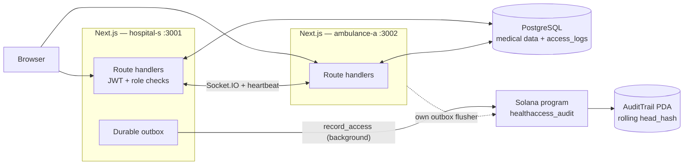

# Mentor deck — HealthAccess

Build Station, technical. Audience: Solana Foundation engineers and ecosystem
partners. This deck is written to survive scrutiny: it states the parts that are
unfinished and the tradeoffs we would defend, because that is the feedback we
actually want.

Reveal rule of thumb: one idea per slide. Speaker notes in italics.

---

## Slide 1 — Title

**HealthAccess**
Tamper-evident medical-record access auditing on Solana.

> *One line: patients can prove nobody rewrote the access log.*

---

## Slide 2 — The problem, precisely

GDPR Art. 15: a patient may ask who accessed their records.
Providers keep an audit log to answer.
The party audited owns the log.

**A log the operator can rewrite is not evidence.**

> *The security boundary is not the database; it is who holds the pen.*

---

## Slide 3 — Our origin, and why it matters here

The course prototype used an **in-memory hash chain with no signatures**.
Tamper-detection was a convention, not a guarantee — a server could rewrite its
own history.

This hackathon: commit the log head to Solana. *Immutable* becomes a chain
property, not a promise.

> *Say this first. It frames the whole design as a response to a real ceiling.*

---

## Slide 4 — Architecture



Medical data never crosses to the chain. Only access *events* do, pseudonymously.

---

## Slide 5 — On-chain state: fixed size, no PII

```rust
#[account]
pub struct AuditTrail {          // 82 bytes total
    version: u8, authority: Pubkey,
    head_hash: [u8; 32], event_count: u64, bump: u8,
}                                // PDA seeds: [b"audit_trail"]

pub struct AccessEvent {         // 83 bytes fixed
    patient_hash: [u8; 32], actor_hash: [u8; 32],
    action: u8, role: u8, record_id: i64, server: u8, timestamp: i64,
}
```

- **No `String`. No `Vec`.** Borsh length is deterministic, so client and program
  produce identical bytes.
- `record_id: i64` uses `-1` as a sentinel rather than `Option`, to keep the
  encoding fixed-length.
- IDs are salted (`ACCESS_HASH_SALT`) and hashed **before** they reach the chain.

> *The predictable question is "why not per-organization trails?" Answer on the
> next slide.*

---

## Slide 6 — The chain and its concurrency model

```
head = sha256( prev_hash || borsh(event) )
```

`record_access` enforces, in order:

1. `require_keys_eq!(trail.authority, authority.key())`
2. `require!(trail.head_hash == prev_hash, ChainBroken)`
3. fold the event into the head, `event_count += 1`, emit `AccessLogged`

**Step 2 is optimistic concurrency.** Two servers race on one PDA; exactly one
wins, the loser gets `ChainBroken` and must re-read the head and retry. This
replaces the old chain's implicit last-write-wins timestamp sort.

> *Tradeoff to raise: one global trail means contention grows with write rate.
> Per-org trails partition that but multiply accounts and cross-org verification.
> We chose the demonstrable-correctness path for a 50-hour build.*

---

## Slide 7 — The durable outbox

```
record access → Postgres row (status = pending)
             → background flusher → record_access → status = anchored
                                                stale head → re-read, retry (ChainBroken)
```

- The row carries `slot`, `signature`, and the committed `head_hash` once anchored.
- Every attempt **re-reads the current head**, so a losing race self-heals.
- Bounded backoff; a row that exhausts attempts is marked `failed`, not lost.

> *Why an outbox: the request path must not fail because Solana is slow. The
> audit record is durable before the chain confirms it.*

---

## Slide 8 — Privacy boundary

| Layer | Holds |
|---|---|
| PostgreSQL | Medical data, notes, real identities |
| On chain | Salted-hashed ids, action, role, record id, server, timestamp |

The chain carries **accountability, not linkable identity**. The hash salt never
leaves the server and is never committed.

Authorization (who may read) is enforced server-side with a JWT in an httpOnly
cookie and role checks. The program does not decide access — it guarantees the
log is append-only.

---

## Slide 9 — Realtime between two servers

The demo runs the same build as two peers (`hospital-s` :3001, `ambulance-a` :3002):

- **Notes** propagate live over Socket.IO.
- **Peers** authenticate `/api/p2p/*` with a shared secret (`x-peer-secret`), not a
  user session.
- Each server runs **its own outbox flusher** against the **same** program, which
  is what makes the `ChainBroken` retry real rather than theoretical.

> *This is the strongest live moment: a note created on one server appears on the
> other, and both anchor into one chain.*

---

## Slide 10 — What is frozen, and why that is a feature

`docs/hackathon/INTERFACE-CONTRACT.md` was signed off **before** implementation,
so the Rust program, the TS client, and the tests could be built in parallel
against one written boundary.

Any change to the 82-byte account, the 83-byte payload, or the two instructions
invalidates that parallelism — so changes happen once, in one place.

> *This is how a solo build stays coherent: the seams are files, not chat.*

---

## Slide 11 — What is unfinished (honest edges)

| Gap | Status |
|---|---|
| Devnet deploy | config complete; blocked on a funded keypair (airdrop rate-limited). Localnet works today. |
| LiteSVM integration tests | blocked on a Solana toolchain collision (SBPFv2 vs SBPFv3); not shipped rather than shipped failing. |
| Patient wallet consent | scoped out — would widen the frozen payload. A direction, not a feature. |
| Trail authority rotation | not implemented; `initialize` fixes the authority to the payer. |
| Write-time truthfulness | **not** guaranteed by on-chain commitment — only retroactive integrity is. |

The app says so too: with an empty `SOLANA_PROGRAM_ID`, `/api/health` reports
`programDeployed: false` and the audit view degrades instead of failing.

---

## Slide 12 — Questions for the Build Station

1. **Trail granularity.** Single global trail vs per-org trails — where is the
   contention/complexity line for a real deployment?
2. **PDA concurrency at scale.** Is re-read-and-retry the right pattern, or would
   you use a queue/leader per trail?
3. **Key management.** Program keypair must stay out of a public repo; how do
   teams make the address reproducible without leaking spend authority?
4. **Verification UX.** What is the most credible way to show a patient "the log
   matches the chain" without asking them to trust our UI?
5. **Scope.** Is self-custodied consent the right next differentiator, or is
   anchoring depth (e.g. batched Merkle roots) the better next step?
